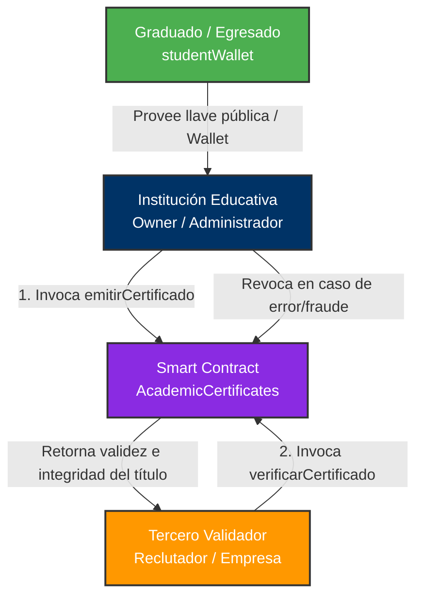

# Guía del Estudiante: EFT Registro Inmutable de Títulos Académicos

**Asignatura:** Fundamentos de Blockchain (BCY0010)  
**Evaluación:** Evaluación Final Transversal (EFT).  

Esta guía proporciona el andamiaje pedagógico y técnico necesario para preparar la **Evaluación Final Transversal (EFT)**. El objetivo es que logres completar el código del Smart Contract, comprender las implicancias normativas en Chile y defender con éxito tu proyecto de manera individual.

---

## 🛠️ Arquitectura del Sistema

El siguiente diagrama ilustra el flujo de interacciones del Smart Contract `AcademicCertificates` entre los diferentes roles del sistema:



---

## 📚 Mapeo de Indicadores de Evaluación (Rúbrica EFT)

| Indicador (IE) | Descripción | Aplicación en el Smart Contract |
| :--- | :--- | :--- |
| **IE2 - Criptografía Aplicada** | Uso de funciones hash e integridad de los datos. | Representado en la variable `hashContenido` (`bytes32`), donde se almacena la firma digital o huella criptográfica del diploma físico para evitar alteraciones. |
| **IE4 - Inmutabilidad y Libro Contable** | Almacenamiento distribuido y persistente del estado del contrato. | Estructurado en el struct `Certificado` y el mapeo `certificados`. Se analiza el comportamiento de la revocación lógica (`activo = false`) frente a la inalterabilidad histórica de la Blockchain. |
| **IE5 - Uso de Wallets y Llaves** | Interacción basada en direcciones públicas y llaves criptográficas. | El mapeo principal vincula las credenciales a la `address` (wallet pública) del egresado, sirviendo como identificador único para la verificación directa. |
| **IE11 - Marco Normativo y Ético** | Evaluación del impacto ético y cumplimiento legal en Chile. | Integrado en los comentarios analíticos y en la sección de defensa teórica referente a la **Ley de Protección de Datos Personales** (Ley N° 19.628) y la **Ley de Infraestructura Crítica** (Ley N° 21.542). |

---

## 🚀 Guía Paso a Paso para Remix IDE

Para compilar y desplegar tu contrato de forma inmediata, sigue estas instrucciones:

1.  **Ingresa a Remix IDE:** Abre [Remix Project](https://remix.ethereum.org/) en tu navegador.
2.  **Crea el Archivo:** En el panel izquierdo ("File Explorer"), crea un nuevo archivo llamado `AcademicCertificates.sol` dentro de la carpeta `contracts`.
3.  **Copia el Código Base:** Pega el contenido del archivo `AcademicCertificates.sol` que se encuentra en la carpeta `src` de este proyecto.
4.  **Configura el Compilador:**
    *   Ve a la pestaña **Solidity Compiler** (ícono de Solidity en el menú izquierdo).
    *   Selecciona la versión del compilador: `0.8.20` o superior.
    *   Haz clic en el botón **Compile AcademicCertificates.sol**.
5.  **Despliega el Contrato (Deploy):**
    *   Ve a la pestaña **Deploy & Run Transactions**.
    *   Asegúrate de que la opción *Environment* esté en `Remix VM (Cancun)` o `Remix VM (Shanghai)`.
    *   Selecciona el contrato `AcademicCertificates` en la lista desplegable.
    *   Presiona el botón **Deploy**. Verás el contrato cargado en la sección "Deployed Contracts" en la parte inferior.

---

## 🎯 Solución de los Desafíos Técnicos (TODOs)

A continuación, se detalla la lógica de programación requerida para completar los bloques `TODO` en el contrato. Estos deben ser implementados por el estudiante en el laboratorio:

### 1. Validación de Wallet del Estudiante (Evitar Address Cero)
Debemos impedir que se emitan credenciales académicas a la dirección nula (`address(0)`), ya que esto equivaldría a perder el certificado de forma permanente en una wallet sin propietario.

```solidity
// Implementación recomendada para el TODO 1:
require(studentWallet != address(0), "La wallet del estudiante no puede ser la direccion cero");
```

### 2. Evitar Certificados Duplicados
Para garantizar que un egresado posea un único registro activo de su titulación académica, verificamos que el folio/ID no haya sido asignado previamente a esa wallet.

```solidity
// Implementación recomendada para el TODO 2:
require(certificados[studentWallet].idCertificado == 0, "Esta wallet ya posee un certificado registrado");
```

### 3. Evitar Hashes Criptográficos Vacíos
Si el hash del diploma físico se guarda vacío (`bytes32(0)`), no hay forma de constatar la integridad del documento en el mundo real.

```solidity
// Implementación recomendada para el TODO 3:
require(hashContenido != bytes32(0), "El hash del contenido no puede estar vacio");
```

### 4. Control de Estado para la Revocación
No tiene sentido intentar invalidar un título que ya fue invalidado previamente o que nunca llegó a existir. Debes forzar que el certificado esté activo antes de apagarlo.

```solidity
// Implementación recomendada para el TODO 4:
require(certificados[studentWallet].activo == true, "El certificado no existe o ya esta inactivo");
```

### 5. Validación de Consultas Públicas
Si un tercero o reclutador consulta una wallet sin certificados válidos, debemos notificarle claramente mediante una excepción en lugar de entregar datos vacíos.

```solidity
// Implementación recomendada para el TODO 5:
require(certificados[studentWallet].activo == true, "No existe un certificado activo para esta wallet");
```

---

## ⚖️ Análisis del Marco Normativo y Ético (Defensa 80%)

Para obtener el puntaje máximo en tu **Defensa Individual**, prepárate para argumentar en torno a los siguientes ejes jurídicos aplicados a la realidad chilena:

### A. Ley N° 19.628 de Protección de la Vida Privada (Chile)
*   **El Dilema:** La ley chilena protege los datos de carácter personal y garantiza el derecho a la cancelación o el "Derecho al Olvido". Sin embargo, Blockchain es técnicamente inmutable (los datos no se pueden borrar de la cadena de bloques una vez confirmados).
*   **La Solución Ética y Técnica:** No se deben registrar nombres legibles ni RUTs en texto plano dentro del contrato. Lo correcto es almacenar únicamente un hash criptográfico de la combinación `hash(RUT + Nombre + Folio)`. De esta forma, si el egresado ejerce su derecho al olvido, los datos personales se borran de las bases de datos externas (*off-chain*), haciendo que el hash en Blockchain se vuelva indescifrable (irreversible), protegiendo su identidad y respetando la normativa legal.

### B. Ley N° 21.542 de Infraestructura Crítica
*   **El Dilema:** Si el Estado de Chile decide centralizar la emisión de todos los títulos universitarios en este Smart Contract, la clave privada de la wallet `owner` (Mineduc o Institución) y los nodos validadores del sistema se constituyen como elementos de infraestructura crítica del país.
*   **La Medida de Seguridad:** La custodia de llaves privadas no puede quedar en manos de un único funcionario de TI. Se exige la implementación de arquitecturas multifirma (Multisig) o esquemas de computación multipartita (MPC), garantizando que se requieran múltiples firmas autorizadas para realizar emisiones o revocaciones, y protegiendo al Estado de hackeos o extorsiones.

### C. Responsabilidad Social del Desarrollador Solidity
*   **La Discusión:** Un error de digitación en una base de datos centralizada tradicional se corrige con un comando `UPDATE`. En Blockchain, ese error quedará registrado por siempre. Como ingenieros, debemos diseñar contratos inteligentes con flujos lógicos claros de "revocación" o "migración", equilibrando la inmutabilidad de la verdad técnica con la falibilidad humana.
